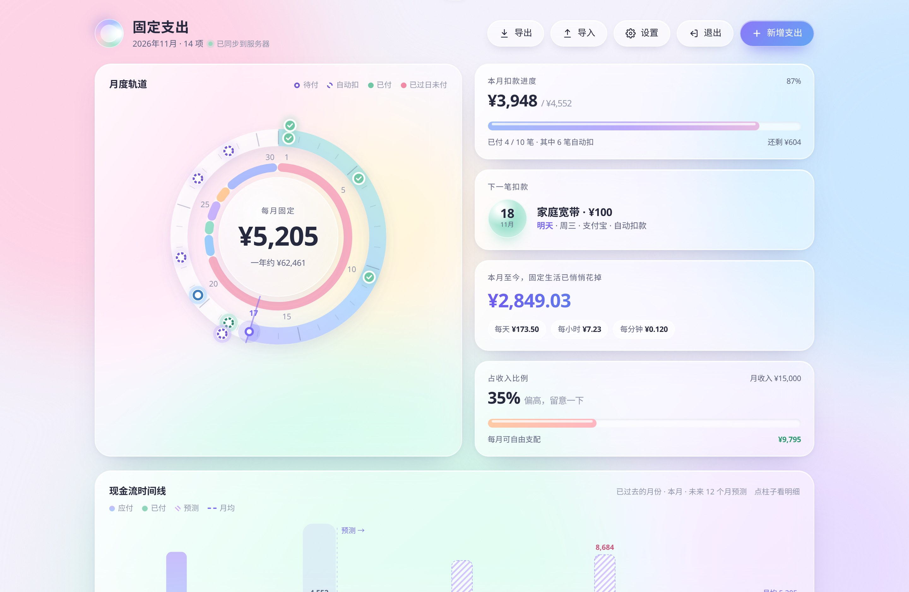
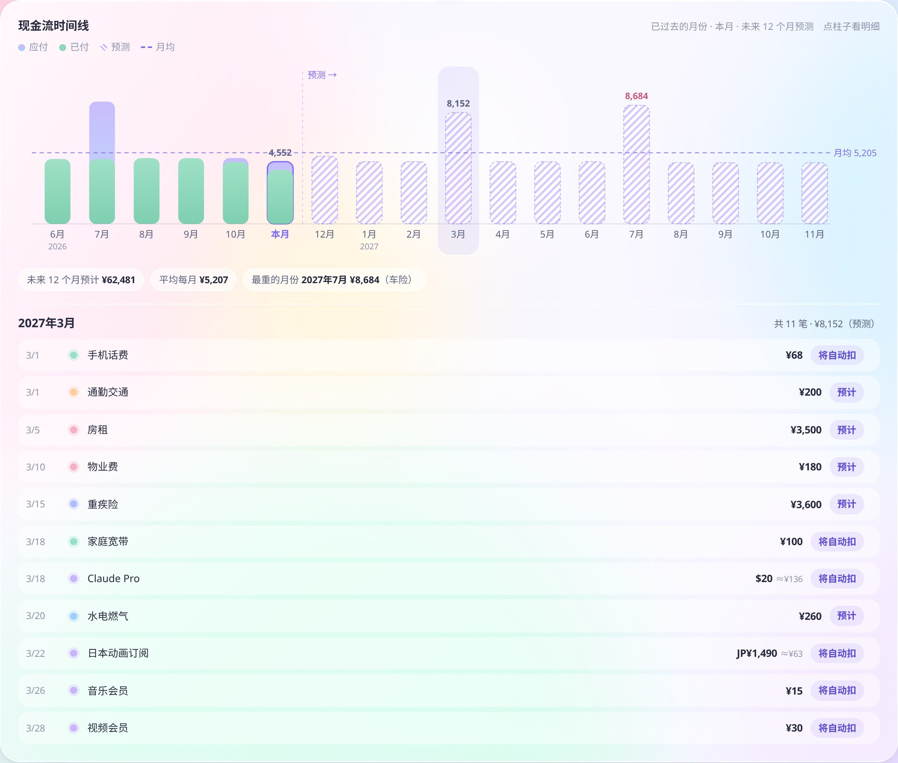
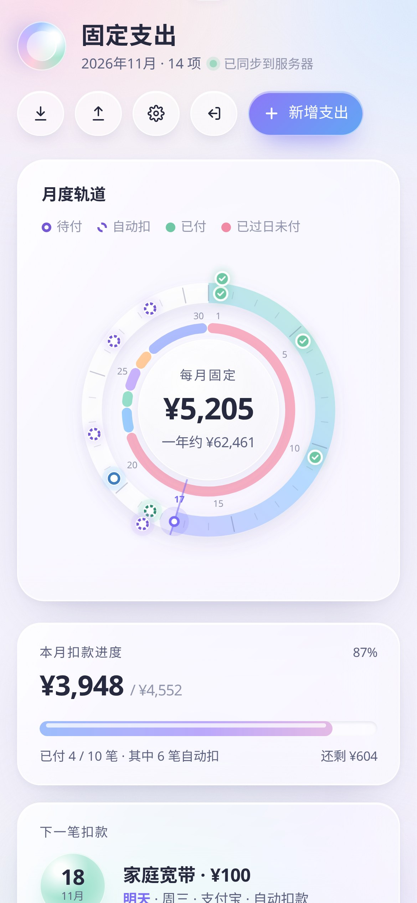

<div align="center">

# 固定支出 · Fixed Expenses

**把每个月雷打不动的钱，放进一张会呼吸的玻璃表盘里。**

自托管的私人固定开销记录工具 —— 房租、话费、会员订阅、保险……<br>
看清每一笔什么时候扣、这个月还要付多少、未来一年哪个月最重，并在扣款前提醒你。




<sub>截图均为演示数据</sub>

</div>

## 为什么做这个

固定支出是最容易被忽略的一笔钱：每一笔都不大，大多自动扣款，又分散在不同的银行卡、支付宝和 App Store 里。等哪天回头一算，一年早已是好几万。

「固定支出」把它们收拢到一个地方，用一张**月度轨道**告诉你这个月的钱会在哪几天离开、哪些已经付了；用**现金流时间线**提前看到未来一年里年费、保险集中扣款的「大月」；再用 **Telegram / Bark** 在扣款前提醒你——尤其是那些「忘了取消就会自动续费」的订阅。

## 亮点

- 🌀 **月度轨道** —— 把一个月画成表盘，指针是此刻，每笔扣款按日期落在轨道上：待付、自动扣、已付、过期一目了然
- 📈 **现金流时间线** —— 过去的实付记录 + 未来 12 个月预测，自动标出最重的月份和月均线
- 🔔 **扣款提醒** —— 每天定时检查，Telegram / Bark 推送；自动续费前提醒你「不需要记得取消」，每月 1 号发本月汇总；机器人和 Bark 直接在页面里设置
- ✅ **在 Telegram 里一键已付** —— 提醒下面带「已付」按钮，点一下就记好，还能撤销；给机器人发 /month 看本月情况，打开着的页面会自动同步
- 📒 **年度报告与预算** —— 每年 1 月推送去年的总结（花在哪、哪些涨价、和前年比）；设每月预算，超出时提醒
- 💱 **多币种** —— 12 种货币按实时汇率折算人民币，可加信用卡外币手续费
- 🧾 **真实的生活场景** —— 月付 / 季付 / 年付、免费试用期、合约到期、临时暂停、涨价记录，都会正确计入每个月
- 💰 **收入占比与试算** —— 固定支出吃掉了收入的几成？砍掉某几项一年能省多少？
- 🔒 **私有、轻量** —— 自己的服务器、密码登录、多设备不互相覆盖、每日自动快照；后端只用 Python 标准库，前端是一个 HTML 文件

## 截图

<table>
  <tr>
    <td width="50%"><br><sub><b>现金流时间线</b>：点柱子查看当月明细，过去的月份可补标已付</sub></td>
    <td width="50%"><br><sub><b>支出卡片</b>：自动扣款、试用期、到期、涨价、暂停一眼可见</sub></td>
  </tr>
</table>

<p align="center"><br><sub><b>手机端</b>：同样的玻璃界面，随时随地查看和标记</sub></p>

## 功能一览

| 功能 | 说明 |
|---|---|
| 月度轨道 | 把一个月画成表盘：指针是此刻，每笔扣款按扣款日落在轨道上（空心 = 待付、虚线 = 自动扣、绿勾 = 已付、红 = 过期未付），内圈是分类占比，点圆点跳到对应卡片 |
| 现金流时间线 | 过去月份的实付记录 + 本月 + 未来 12 个月预测，标出最重的月份（年付、季付扣款月）和月均线；点柱子查看当月明细，过去的月份也能补标已付 |
| 扣款提醒 | 每天定时检查，通过 **Telegram / Bark** 推送：手动付款提前 N 天、扣款当天、过期未付；自动续费提前提醒「不需要记得取消」；年付季付提前 7 天；每月 1 号发本月汇总 |
| 自动扣款 / 自动续费 | 到扣款日自动算作已付；扣款失败可标记「未扣成功」 |
| 试用 / 到期 | 免费试用到期前不计费并提前 3 天提醒；合约到期后不再计入并提前 7 天提醒 |
| 暂停 | 暂时不扣的项目（比如健身卡冻结）可以暂停，暂停期间不计入任何金额，恢复后接着算 |
| 涨价记录 | 改金额时自动记一笔价格历史，卡片上显示「↑ 涨 ¥14/月 · 10月起」，过去的月份按当时价格计算 |
| 多币种 + 手续费 | 12 种货币折算人民币（汇率每天抓取一次并留存历史，已扣过的按扣款当天汇率计算），可设置信用卡外币手续费（如 1.5%） |
| Telegram 一键已付 | 提醒消息带「✅ 已付」按钮，点击即标记（可撤销），只接受你自己聊天里的点击；/month 查看本月情况 |
| 年度报告 | 页面随时查看任一年；每年 1 月自动推送去年的报告：总额、月均、分类、单项排行、价格变化、与前年对比 |
| 每月预算 | 月均超出预算时页面提示，并推送一次（项目或预算变了才会再提醒） |
| 退出其他设备 | 一键让其他所有设备上的登录失效，当前设备保持登录 |
| 支付方式汇总 | 按分类或按支付方式（每张卡、支付宝……）查看每月被扣多少，方便和账单核对 |
| 收入占比 | 填上月收入，显示固定支出占几成、每月还剩多少可自由支配 |
| 本月进度 / 下一笔 | 本月应付、已付、剩余，下一笔扣款倒计时 |
| 实时消耗 | 「本月至今已花掉」的跳动金额，以及每天 / 每小时 / 每分钟的固定成本 |
| 试算取消 | 临时把某几项划掉，看每月、每年能省多少（不保存） |
| 导入 / 导出 | JSON 备份与恢复 |

## 扣款提醒

提醒由后端的 `notify.py` 负责：服务启动后每分钟检查一次，到了设置里的「每天检查时间」（默认 09:00）就把当天需要提醒的内容合并成一条消息发出；同一件事只提醒一次，发送失败 15 分钟后重试。

在页面的「设置」里可以**直接填写自己的 Telegram 机器人（Bot Token + Chat ID，可一键自动获取 Chat ID）和 Bark（服务器地址 + 设备 Key）**，保存前会先验证 Token 是否有效、机器人能否给这个聊天发消息；还可以开关渠道、调整提前天数、查看「今天的提醒预览」并发送测试推送。

推送凭据单独保存在服务器的 `data/notify-config.json`（权限 600），不会出现在账单数据、导出文件或备份里，页面上只显示末尾 4 位。`config/app.env` 里的 `GZ_TG_*` / `GZ_BARK_*` 只作为页面没设置时的默认值。

## 部署

```bash
# 1. 代码放在 /root/固定支出
mkdir -p data && chmod 700 data

# 2. 配置
cp config/app.env.example config/app.env && chmod 600 config/app.env
python3 server.py --hash                                   # 输入密码，把输出填到 GZ_PASSWORD_HASH
python3 -c "import secrets;print(secrets.token_hex(32))"   # 填到 GZ_SECRET

# 3. 启动（监听 Docker 网桥 172.18.0.1:8130，供反向代理访问）
cp deploy/guding-zhichu.service /etc/systemd/system/
systemctl daemon-reload
systemctl enable --now guding-zhichu
```

反向代理示例见 `deploy/nginx-zhichu-location.conf`（挂在 `/zhichu/` 子路径；前端全部使用相对路径，任意子路径都可用）。

改密码：`python3 server.py --hash`，替换 `config/app.env` 里的 `GZ_PASSWORD_HASH` 后 `systemctl restart guding-zhichu`。

## 目录

```
server.py                         后端：页面、登录、数据读写（带版本号）、每日快照、汇率缓存
notify.py                         扣款提醒：规则计算、定时检查、Telegram / Bark 推送
public/index.html                 前端：全部界面与逻辑
config/app.env.example            配置示例（真正的 app.env 不提交）
deploy/guding-zhichu.service      systemd 服务
deploy/nginx-zhichu-location.conf 反向代理 location 示例
docs/                             README 截图
data/                             运行时数据（不提交）
```
